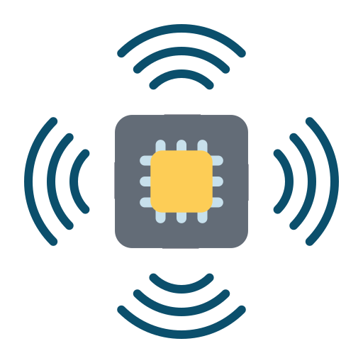

#  Orange Sensors

This repository contains Orange Data Mining widgets to access data from [Smart Citizen](https://smartcitizen.me) and [STAplus](https://docs.ogc.org/is/22-022r1/22-022r1.html). These widgets allow users to easily access sensor data using _Visual programming_ tools, in particular [Orange Data Mining](https://orangedatamining.com/), a popular `python` based interface for working with data.


These tools are midway between web-based tools for data analysis (with no installation, but not very flexible) and more advanced data tools (that require a more complex installation process, but that bring in high flexibility). Using the tools in this repository allows for a low-barrier in the installation process, and later on use already existing tools developed for the comprehensive _Orange framework_.

This repository contains the source code for these widgets and it forms part of the **CitiObs project**, and has received funding from the European Union. See [Funding](#funding) section.

## Examples

Examples on how to use these widgets can be found at the [Smart Citizen Documentation](https://docs.smartcitizen.me/guides/data/visual-programming/#examples).

**Note**: this project has been inspired by [MECODA-Orange](https://github.com/eosc-cos4cloud/mecoda-orange).

##  Smart Citizen widgets

The first widget (Smart Citizen Search) collects data from the Smart Citizen API. It allows to select the device either via device ID (the number after https://smartcitizen.me/kits/[...]) or by searching the API by city, tags, or device type. The second widget (Smart Citizen Data) uses the data from the first one and collects timeseries tabular data from a device, with a defined `rollup` (i.e. the frequency of the readings), minimum and maximum date; as well as resample options.

##  STAPlus widgets

The STAplus node requires the `secd_staplus_client` library.

## Development

Clone and install in editable mode with your environment of preference:

```
git clone git@github.com:fablabbcn/orange-sensors.git
cd orange-sensors
```

```
pip install -e .
```

Run orange canvas:

```
python -m Orange.canvas
```

## Funding


Funded by the European Union. Views and opinions expressed are however those of the author(s) only and do not necessarily reflect those of the European Union or the European Research Executive Agency (REA). Neither the European Union nor the granting authority can be held responsible for them.
